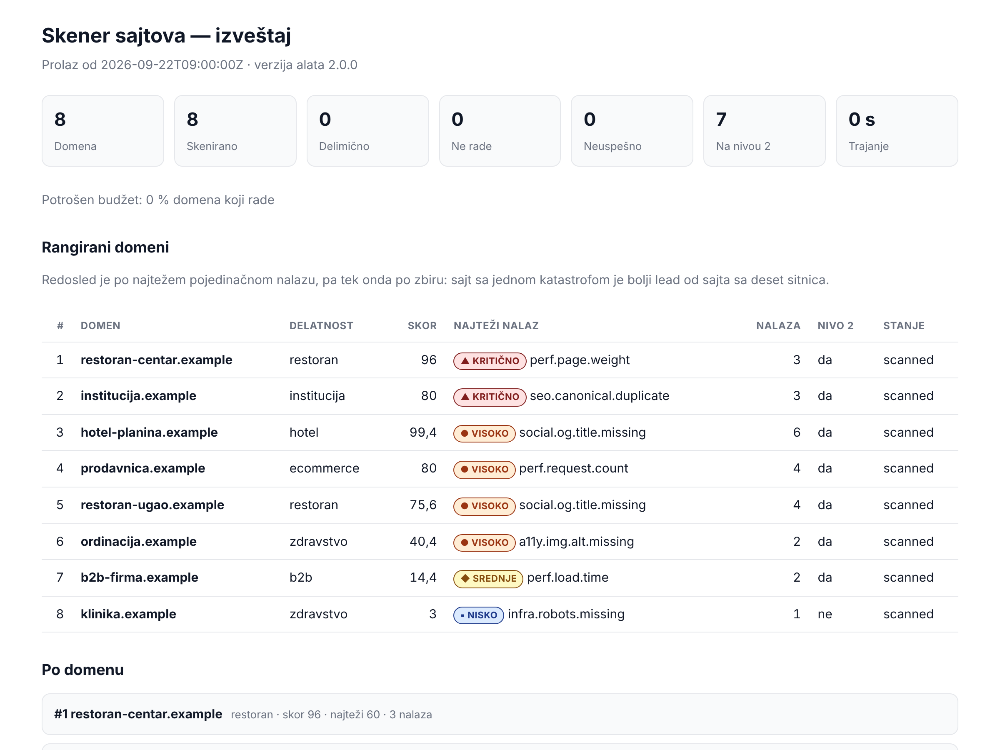

# SiteTriage (skener sajtova)

Skener prolazi kroz listu domena, obično stotinak do dvesta, i pravi rangiranu listu sajtova koji
zaslužuju pun ručni audit. Uz svaki sajt ide nekoliko rečenica na srpskom ili engleskom koje se mogu
iskoristiti u poruci, pozivu ili kontakt formi. Audit ne zamenjuje. Kaže ti gde da potrošiš vreme.



> Izveštaj sa slike je napravljen nad ispitnim skupom iz specifikacije. Ceo HTML je u
> [`docs/primer-izvestaja.html`](docs/primer-izvestaja.html). To je jedan fajl, bez CDN-a, i otvara se
> bez mreže.

## Šta alat namerno ne radi

- Ne skenira portove, ne pokušava prijavu, ne traži ranjivosti i ne popunjava forme.
- Ne ide dublje od početne strane i uzorka iz `sitemap.xml`. Kad mape nema, uzima interne linkove.
- Ne dira nijednu putanju koju `robots.txt` zabranjuje.
- Ne pogađa delatnost sajta. Delatnost je ulazni podatak, ne zaključak.
- Ne popravlja ništa. Alat čita, nikad ne piše.

## Pokretanje

Najlakše je preko Docker-a. U slici je Chromium tačno za verziju Playwright-a iz `pyproject.toml`,
pa se merenje u browseru ponaša isto na svakoj mašini.

```bash
git clone https://github.com/lazicmilos/sitetriage.git
cd sitetriage
mkdir rad
docker compose build
docker compose run --rm sitetriage pytest -q        # svi testovi moraju da prođu
```

Pre prvog skeniranja upiši ko skenira. Administrator svakog sajta u logu servera vidi User-Agent, i iz
njega mora da zna ko ga posećuje i kako da ga kontaktira. Bez toga alat odbija da pošalje i jedan
zahtev. Napravi `rad/moj.toml`:

```toml
[operator]
name = "Web studio Primer"
contact = "kontakt@primer.rs"
```

Isto može i preko promenljivih okruženja `SITETRIAGE_OPERATOR_NAME` i `SITETRIAGE_OPERATOR_CONTACT`, koje `compose.yaml`
prosleđuje u kontejner. Ime sme da bude i ćirilicom ili sa „š" i „đ". Alat ga za zaglavlje prevodi u
latinicu bez kvačica, jer HTTP zaglavlje prima samo ASCII.

```bash
docker compose run --rm sitetriage sitetriage scan /rad/leads.csv --config /rad/moj.toml --out /rad/izvestaj
```

Na Linux-u pre toga postavi `SITETRIAGE_UID=$(id -u)` i `SITETRIAGE_GID=$(id -g)`, da izveštaji u `rad/`
pripadaju tebi. Docker Desktop na Windows-u i Mac-u to rešava sam.

Preporučena mašina ima 16 GB RAM-a i vezu od bar 50 Mb/s. Za nju je cilj da lista od 200 domena
traje do 15 minuta (Z-32). Alat radi i na slabijoj mašini, samo duže, jer lagani nivo 2 pokreće
onoliko browsera koliko mašina podnese: jedan na svaki slobodan GB memorije, najviše dva po jezgru i
najviše 8. Broj može da se fiksira u `[browser] light_concurrency`.

Bez Docker-a treba Python 3.11 ili noviji:

```bash
pip install -e '.[browser]'
playwright install chromium
```

## Ulaz i izlaz

Ulaz je CSV sa zaglavljem, ne gola lista domena:

```csv
domain,industry,note
hotel-planina.example,hotel,planina
restoran-centar.example,restaurant,
klinika.example,healthcare,kontrolni čist sajt
```

`industry` je jedno od `hotel`, `restaurant`, `healthcare`, `ecommerce`, `b2b`, `institution` i
`other`. Prazno polje i nepoznata vrednost padaju na `other`. Delatnost menja koliko koji nalaz
vredi: slika za deljenje linka je hotelu važna, a b2b sajtu skoro nebitna.

Lista najčešće stiže iz Excel-a, pa alat prihvata i ono što Excel pravi na srpskom Windows-u: kolone
razdvojene sa `;` i fajl sačuvan u windows-1250 umesto UTF-8. Domen koji se ponavlja skenira se
jednom, a važi prvo pojavljivanje.

U izlaznom folderu su `index.html` (izveštaj), `findings.csv` (red po nalazu), `summary.csv` (red
po domenu), `report.json` (ceo prolaz, za programe) i `snapshots/` sa sirovim podacima svakog
domena. `--format` bira koje od prva četiri se pišu; snapshoti se pišu uvek.

Rangiraju se samo sajtovi koji rade. Sajt koji se ne otvori ni u drugom pokušaju, najranije 60 s
posle prvog (`http.second_attempt_after_s`), ide u odeljak „Ne rade", sa posebnim predlogom teksta.
To važi samo kad je stanje sigurno: ime ne postoji u DNS-u ili nema adresu, ili server ne prihvata
vezu ni preko https ni preko http. Domen koji iz drugog razloga nema početnu (DNS privremeno nedostupan, prekinuto
TLS rukovanje, bilo kakav HTTP odgovor, adresa koja nije javna) ide u „Nije skenirano", sa razlogom,
jer sajt možda radi, samo ga alat nije video. Tu je i broj izuzetih domena.

### JSON izveštaj

`report.json` je ugovor za web aplikaciju, `sitetriage diff`, CRM i kupca koda. Oblik opisuje šema
[`sitetriage/schema/report-3.json`](sitetriage/schema/report-3.json), a verzija šeme je prvo polje
dokumenta (`schema_version`). Uz nju idu verzija alata, vreme prolaza u UTC-u, trajanje po nivou,
otisak konfiguracije (`config_digest`: sha256 pragova, množilaca i bodova, bez identiteta i
paralelizma), okruženje (OS, Python, Chromium) i zbir po statusu. Domeni su u tri liste:
`ranked`, `unreachable` („Ne rade") i `not_scanned` (`failed`, sa razlogom u `reason`).

Domen je `partial` iz dva razloga, a `partial_causes` kaže iz kog: potrošen budžet (`budget`) ili
provera koja nije mogla da se izvrši (`unknown`). Zbir ih broji posebno, a `budget_share` i
`unknown_share` daju udeo budžeta među domenima koji rade i udeo `unknown`-a za svaku proveru.
Imenilac su domeni koji rade i na kojima je provera pokrenuta, pa za proveru nivoa 2 samo oni koji
su prošli nivo 2, a za vreme učitavanja samo oni mereni pod profilom. Oba udela su izlazni kriterijumi
v2, a HTML izveštaj ih prikazuje ispod zbira.

Nalaz u JSON-u nema rečenicu, nego `check_id`, dokaz i `variant`. Rečenica se pravi iz dokaza,
na jeziku onoga ko čita.

Pravila promene šeme ([ADR-011](docs/adr/ADR-011-json-sema.md)):

- dodato polje podiže drugi broj (`3.0` → `3.1`), jer ga stari čitalac može preskočiti;
- obrisano polje, promenjen tip ili značenje polja i preimenovan `check_id` podižu prvi broj
  (`3.x` → `4.0`).

Šema ne dozvoljava nepoznata polja, pa novo polje mora prvo u šemu. Test pada ako izlaz ne
prolazi šemu.

### Ostale komande

```bash
sitetriage recheck izvestaj/snapshots/ --out novi/                  # ponovo boduje sačuvano, bez mreže
sitetriage recheck izvestaj/snapshots/ --config probni-pragovi.toml --out novi/
sitetriage recheck izvestaj/snapshots/ --lang en --out english/     # isti prolaz, izveštaj na engleskom
sitetriage record moji-domeni.csv --out snimci/
sitetriage explain seo.canonical.duplicate
sitetriage explain --all --markdown                                 # odavde je tabela provera ispod
sitetriage scan domains.csv --level 1 --concurrency 4 --only institucija.example --debug-domain institucija.example
```

`recheck` je glavni alat za kalibraciju. Promeniš prag, pustiš ga nad sačuvanim snapshotima i za
sekund vidiš razliku, bez ponovnog skidanja dvesta sajtova. Pragovi se probaju u posebnom fajlu, jer
se `--config` spaja preko `sitetriage.toml` i menja samo ono što u njemu piše.

## Kako je podeljen

Najvažnija odluka nije podela na nivo 1 i nivo 2, nego ova: kod koji dodiruje mrežu i kod koji
donosi zaključke su dva odvojena sloja. Provera nikad ne otvara vezu. Dobija već prikupljene podatke
i vraća nalaze.

```
domains.csv → Fetcher L1 (httpx, async) → SiteSnapshot na disk → provere L1 → nalazi
                                                                      ↓
                                                            politika eskalacije
                                                                      ↓
                                     Fetcher L2 (Playwright) → BrowserSnapshot → provere L2
                                                                      ↓
                                              bodovanje → rangiranje → CSV + HTML
```

Zato testovi rade bez mreže i uvek daju isti rezultat, kalibracija ne traži novi prolaz, a kad neki
domen da čudan rezultat, tačan ulaz koji ga je proizveo stoji sačuvan na disku.

| Modul | Odgovornost | Mreža | Disk |
|---|---|---|---|
| `cli` | argumenti, log, izveštaji | ne | čita |
| `inputs` | lista domena i drugi CSV-ovi iz Excel-a; greške i upozorenja sa brojem reda | ne | ne |
| `pipeline` | redosled faza: nivo 1 → eskalacija → nivo 2 → lagani nivo 2 → bodovanje → rangiranje | kroz `fetch.*` | kroz `store` |
| `config` | pragovi iz TOML-a, identitet operatera | ne | čita |
| `models` | šeme podataka, serijalizacija | ne | ne |
| `fetch.urls`, `fetch.page`, `fetch.robots`, `fetch.sitemap` | normalizacija i parsiranje | delom | ne |
| `fetch.http` | nivo 1 | da | ne |
| `fetch.browser` | nivo 2 | da | ne |
| `checks.*` | pravila: ulaz je snapshot, izlaz nalazi | ne | ne |
| `messages` | rečenice za klijenta i operatera, oznake izveštaja, nacrt mejla; sr i en | ne | ne |
| `score` | bodovanje, rangiranje, eskalacija | ne | ne |
| `store`, `report.*` | snapshoti i izveštaji | ne | piše |

`checks.*` ne uvozi `httpx`, `playwright` ni `fetch.*`, osim `fetch.urls`. Ako proveri zatreba nešto
sa mreže, znači da u snapshotu fali polje, pa se dodaje polje. `cli` ne uvozi `fetch.http`,
`fetch.browser` ni `score`: redosled faza postoji samo u `pipeline`-u, pa ga web aplikacija zove, a
ne kopira ([ADR-008](docs/adr/ADR-008-pipeline.md)). Oba pravila proverava `tests/test_arhitektura.py`.

## Provere

Tabela je generisana iz registra (`sitetriage explain --all --markdown`). Kad se promeni prag, tabela se
generiše ponovo; CI proverava samo da u njoj nije izostala nijedna provera iz registra.

| `check_id` | Nivo | Kategorija | Ozbiljnost | Prag |
|---|---|---|---|---|
| `i18n.lang.invalid` | 1 | i18n | medium | lang ∈ {zxx, und, prazno} ili ne parsira kao BCP-47 |
| `i18n.lang.mismatch` | 1 | i18n | medium | sadržaj prepoznat kao sr (ćirilica > 30 % ili dijakritici > 0,5 %) uz lang jezika koji se ne piše ćirilicom ni sa č/ć/š/ž/đ (nije sr, hr, bs, ru, mk, bg…) |
| `i18n.lang.missing` | 1 | i18n | medium | atribut lang ne postoji |
| `infra.host.duplicate` | 1 | infra | medium | varijante vraćaju 200 na oba hosta (www i bez www); low ako canonical na svima upućuje na isto poreklo; neproverena varijanta hosta koji nije viđen → unknown |
| `infra.https.redirect.missing` | 1 | infra | medium | https na konačnom hostu vraća 200 sa ispravnim sertifikatom, a http:// istog hosta vraća 200 bez preusmerenja na https; TLS greška ili neposlat zahtev → unknown; https ne radi → ne primenjuje se |
| `infra.robots.missing` | 1 | infra | low | status 404 ili 410; ostali statusi osim 200 → unknown |
| `infra.sitemap.missing` | 1 | infra | medium | status 404 ili 410, ili 200 sa 0 URL-ova; ostali statusi → unknown; ima URL-ova → ok |
| `infra.soft404` | 1 | infra | high | obe sonde vraćaju konačni status 200 (§5.2); status van {200, 404, 410} → unknown |
| `infra.tls.invalid` | 1 | infra | high | TLS provera odbila sertifikat; nepotpun lanac (nema međusertifikata) → unknown |
| `infra.unreachable` | 1 | infra | critical | oba pokušaja, u razmaku od bar http.second_attempt_after_s (60 s): EAI_NONAME ili EAI_NODATA, ili TCP veza odbijena ili istekla i na https i na http; bilo kakav HTTP odgovor → ok |
| `perf.compression.missing` | 1 | perf | low | content-encoding ∉ {gzip, br, zstd, deflate} i HTML > 50 kB |
| `perf.html.size` | 1 | perf | low | html_bytes > thresholds.perf.html_size_kb (500 kB) |
| `perf.redirect.chain` | 1 | perf | low | broj skokova ≥ thresholds.perf.redirect_hops (3) |
| `seo.canonical.duplicate` | 1 | seo | critical | ≥ 2 stranice sa tuđim canonical-om ka istoj adresi, iz ≥ 2 grupe putanja; udeo u uzorku ≥ 0,4 high · ≥ 0,6 critical · inače medium |
| `seo.canonical.missing` | 1 | seo | high | nema oznake na početnoj |
| `seo.description.duplicate` | 1 | seo | medium | ≥ 3 stranice iz ≥ 3 različite grupe putanja sa istim opisom |
| `seo.description.missing` | 1 | seo | medium | prazan ili nepostojeći meta opis |
| `seo.title.duplicate` | 1 | seo | high | ≥ 3 stranice iz ≥ 3 različite grupe putanja sa istim naslovom |
| `seo.title.missing` | 1 | seo | high | prazan ili nepostojeći <title> |
| `social.og.description.missing` | 1 | social | medium | nedostaje <meta property=og:description> |
| `social.og.image.missing` | 1 | social | medium | nedostaje <meta property=og:image> |
| `social.og.title.missing` | 1 | social | high | nedostaje <meta property=og:title> |
| `a11y.img.alt.missing` | 2 | a11y | low | ≥ 5 slika i udeo bez alt atributa > 0,5; > 0,8 uz ≥ 15 slika → high; healthcare/institution → bar medium |
| `perf.img.oversized` | 2 | perf | medium | ≥ 3 slike sa odnosom > 2,5 i izmerenim viškom, ili procenjen višak > 700 kB; SVG i data: slike se ne broje |
| `perf.load.time` | 2 | perf | high | > 6 s medium · > 9 s high · prekid posle tvrdog limita = high |
| `perf.page.weight` | 2 | perf | critical | preneto do load, bez videa: > 2 MB medium · > 4 MB high · > 7 MB critical |
| `perf.request.count` | 2 | perf | high | zahtevi do load: > 60 medium · > 90 high |
| `qa.console.errors` | 2 | qa | low | > thresholds.qa.console_errors (3) |
| `seo.h1.missing` | 2 | seo | high | h1_count == 0 posle učitavanja u browseru |
| `seo.h1.multiple` | 2 | seo | low | h1_count > thresholds.seo.h1_multiple (3) |

Svaka provera vraća jedno od tri stanja: `ok`, `finding` ili `unknown` sa obaveznim razlogom. Bez
trećeg stanja ne razlikuješ „čisto" od „nije provereno", a baš ta razlika te za mesec dana košta
poverenja u sopstveni izveštaj. Primer: kad sajt na svaki zahtev vrati 403 jer blokira botove, alat
ne tvrdi da mu fali `robots.txt`. Kaže da ne zna.

Četvrto stanje je `not_applicable`, isto sa obaveznim razlogom: provera nema šta da proveri. Provere
duplikata ga daju kad sajt stvarno ima manje od tri stranice. Mali uzorak nije dovoljan, jer je
uzorak mali i kad budžet istekne ili kad veze crta JavaScript. Zato se broje adrese iz mape sajta, iz
veza sa početne i iz veza koje vidi browser, a bar jedan izvor mora da vidi sadržaj koji crta
JavaScript. Kad neki od tih uslova ne važi, provera je `unknown`. Za razliku od `unknown`,
`not_applicable` ne čini domen delimično skeniranim. Kad mapa sajta navodi manje adresa nego što
uzorak traži, uzorak se dopunjava vezama sa početne.

Rečenice za klijenta tvrde samo ono što je proverljivo, a svaki broj u njima dolazi iz izmerenog
dokaza. Oba pravila čuvaju testovi u `tests/test_poruke.py`, uz slaganje broja i imenice („4 glavna
naslova", „5 glavnih naslova", „4 main headings").

Nalaz nosi samo dokaz: brojeve, URL-ove i tehničke kodove. Rečenicu pravi katalog u
`sitetriage/messages/` tek pri prikazu, na jeziku koji bira `--lang sr|en`
([ADR-009](docs/adr/ADR-009-katalog-poruka.md)). Zato isti prolaz može da se prikaže na oba
jezika. Engleska rečenica tvrdi tačno isto što i srpska, ni više ni manje, a `sitetriage explain`
ispisuje obe. Isto važi za razloge zašto nešto nije provereno i zašto je domen poslat na nivo 2.

## Zašto su pragovi baš takvi

| Prag | Vrednost | Obrazloženje |
|---|---|---|
| težina početne | 2 / 4 / 7 MB prenetih bajtova, bez videa | Zaokruženi p50, p75 i p90 sa liste A, 58 sajtova izmerenih do `load` (2,2, 3,6 i 7,3 MB). Broji se ono što je stvarno stiglo preko mreže. JS i CSS putuju sažeti, pa je raspakovano telo kod jednog sajta pokazivalo 25 MB, a preneto je 3,8 MB. Video se ne računa, jer se skida koliko vreme merenja dozvoli: isti sajt je u jednom prolazu preneo 77 MB videa, a u drugom 39 MB. Broje se samo zahtevi započeti pre događaja `load`, i isto važi za broj zahteva. Posle `load` stižu analitika, chat i lenje slike, pa je isti sajt jednom imao 179, a drugi put 281 zahtev. Ukupno, sa onim posle `load`, stoji samo u tehničkoj rečenici. |
| broj zahteva do `load` | 60 / 90 | Zaokruženi p50 i p75 sa liste A (57 i 87). Kod provera sa dva nivoa isti percentil daje istu ozbiljnost kao kod težine: p50 medium, p75 high. |
| vreme do `load` | 6 / 9 s, pod mrežnim profilom | Zaokruženi p50 i p75 sa liste A (5,6 i 9,3 s), izmereni pod profilom sa brze stvarne veze. Rok od 25 s je p95 (22,1 s) plus rezerva. |
| vreme učitavanja | meri se jedno po jedno | Kad se tri sajta učitavaju odjednom, dele istu vezu i produžavaju jedan drugom vreme i do 4,6 puta. Zato se do događaja `load` učitava jedan po jedan, a skrol i čitanje stranice idu paralelno. |
| dijakritici za prepoznavanje srpskog | 0,005 | Srpski latinicom ima 2–5 % dijakritika, engleski nula. Prag je deset puta niži od očekivanog da izdrži kratke tekstove, a i dalje je deset puta iznad šuma. |
| pogrešna oznaka jezika | medium | Google jezik stranice određuje iz sadržaja i `lang` ne koristi. Posledica je pristupačnost (čitači ekrana), ne pozicija u pretrazi. |
| nesažet HTML | low | Na samom HTML-u ušteda je desetinke sekunde. Poruka kaže tačno koliko, izračunato iz veličine. |
| odnos za predimenzionirane slike | 2,5 | Ekrani sa `devicePixelRatio` 2 legitimno traže duplo veću sliku. Prag od 2 bi svaki ispravno urađen retina sajt proglasio pokvarenim. |
| duplikati | ≥ 3 stranice iz ≥ 3 grupe putanja | Osam blog postova sa istim naslovom šablona nije isto što i ceo sajt koji se Google-u predstavlja kao jedna stranica. |
| prazan HTML za eskalaciju | 800 znakova | Namerno drugačije od praga jezičke heuristike (400): 400 je granica pouzdanosti prepoznavanja jezika, a 800 granica „ovo izgleda kao prazan HTML". |
| spora početna za eskalaciju | 1500 ms | Jedini uslov koji hvata sajt sa čistim SEO-om i sporom stranicom. |
| gornji limit za nivo 2 | 60 domena | Bez limita, na listi od 200 domena skoro sve ide na nivo 2 i prolaz traje sat vremena. Prvi idu sajtovi bez jakog nalaza nivoa 1, jer je njima nivo 2 jedina šansa da se nešto nađe. Sajt koji već ima jak nalaz ima i razlog za mejl. Ostali sajtovi sa početnom koja radi dobijaju lagani nivo 2: browser bez mrežnog profila, više sajtova odjednom, posle punog nivoa 2. Meri težinu, zahteve, h1, alt i slike, a vreme učitavanja „ne primenjuje se", pa sajt zbog toga nije `partial`. Brz i čist HTML ne govori ništa o težini strane: na listi B dve strane od 4,8 i 4,9 MB nisu imale nijedan razlog za eskalaciju (BUG-020). |
| nemereni odgovori | > 5 → `unknown` | Merenje kojem ne veruješ gore je od merenja koje nemaš. |
| bodovi po ozbiljnosti | 40 / 20 / 8 / 3 | Razmak je namerno nelinearan: jedan `critical` mora da nadjača pet `low` nalaza. |
| mrežni profil nivoa 2 | 4,8 Mb/s (0,6 MB/s) dolazno, 1,5 Mb/s odlazno, 150 ms kašnjenja | Nivo 2 meri pod ovom simuliranom vezom (`[network_profile]`), pa isti sajt daje isto vreme na kućnoj vezi, na serveru i kod kupca. Iz iste brzine se računaju sekunde u rečenicama za klijenta, i ta brzina piše u samoj rečenici. Broj koji šalješ klijentu moraš umeti da odbraniš. Procesor se ne simulira, pa vreme i dalje malo zavisi od mašine; mrežni deo je fiksan ([ADR-010](docs/adr/ADR-010-mrezni-profil.md)). Profil može samo da uspori, pa alat pre nivoa 2 preuzima probni fajl (`probe_url`, podrazumevano `speed.cloudflare.com`) i meri stvarnu vezu. Ako je sporija od 2 × profila, vreme učitavanja je `unknown`, jer bi bilo precenjeno. |

Rangiranje ne ide po zbiru nego po paru (najteži pojedinačni nalaz, zbir). Sajt sa jednom katastrofom
je bolji lead od sajta sa deset sitnica: prvi ima jedan jasan razlog da ti odgovori, a na listu od
deset stavki se retko ko javi.

Svi pragovi su u [`sitetriage.toml`](sitetriage.toml), ne u kodu, pa je `git diff` nad njim čitljiva istorija
odluka iz kalibracije. Svaka odluka je upisana i u [`docs/kalibracija.md`](docs/kalibracija.md).

## Testovi

```bash
docker compose run --rm sitetriage pytest -q               # bez mreže, sa pravim Chromium-om, oko 4 min
docker compose run --rm -e SITETRIAGE_LIVE_CSV=/rad/live.csv sitetriage pytest -m live -v   # pravi sajtovi sa tvoje liste, traži mrežu
```

Prvi sloj ne zavisi od mreže i vrti se u CI-ju na svaki push. Tu su sve provere nad snapshotima,
bodovanje, normalizacija URL-ova i parsiranje sitemapa. Tu su i integracioni testovi protiv lokalnog
HTTP servera koji namerno servira pokvaren sajt: sporo telo odgovora, strim koji se nikad ne završi,
zaštitu od botova, mapu sajta sa devet delova. Tako se proveravaju budžet po domenu, pauze, semafori i
merenje u browseru. Drugi sloj ide na prave sajtove i isključen je po defaultu, inače bi CI padao
svaki put kad nekom sajtu istekne sertifikat.

Osnova je čist sajt na kome nijedna provera ne sme ništa da nađe. Svaki pozitivan test kvari tačno
jednu stvar i proverava da nije probudio ostale provere. Pragovi imaju testove graničnih vrednosti
(granica − 1, granica, granica + 1), a pravila sa više uslova imaju tabele odlučivanja. Oznaka tehnike
je u imenu slučaja: `gv-` granična vrednost, `ke-` klasa ekvivalencije, `tab-` tabela odlučivanja,
`st-` prelaz stanja, `pg-` pogađanje grešaka.

CI pada ako pokrivenost linija i grana spadne ispod 95 % (sada je 98 %). Kvalitet samih testova
meri mutaciono testiranje: mutmut namerno kvari kod, a testovi moraju da primete svaku izmenu koja
menja ponašanje. mutmut 3.2.3 ne pravi mutante u funkcijama sa dekoratorom, pa tela provera
(`@check`) ne mutira. Pokreće se kroz Docker, jer mutmut ne radi na Windows-u, i traje oko 20 minuta:

```bash
docker compose run --rm sitetriage python scripts/mutacije.py
```

Kako se testira i šta je nađeno opisuju [plan testiranja](docs/plan-testiranja.md),
[izveštaj o prvom prolazu nad 100 pravih domena](docs/izvestaj-testiranja-100.md),
[izveštaj o ciklusu ispravki](docs/izvestaj-testiranja-2.md),
[izveštaj o v2: kalibracija na listi A i provera na listi B](docs/izvestaj-testiranja-3.md) i
[pregled kroz ISO/IEC 25010](docs/kvalitet.md).

> Fixture-i u `tests/fixtures/` su ručno napisani, nisu snimljeni sa pravih sajtova. Opisuju ono što
> specifikacija tvrdi za tih osam domena i proveravaju da lanac provera radi nad tim stanjem, sa
> pragovima iz specifikacije. Domeni su izmišljeni (`.example`). Stvarne sajtove proverava
> `pytest -m live`, nad listom iz `SITETRIAGE_LIVE_CSV`.

## Etika

```
User-Agent: SiteTriage/3.0.0 (+kontakt@primer.rs; Web studio Primer)
```

Ime alata, ko skenira i kako da ga kontaktira moraju biti u svakom zahtevu. Bez toga si anonimni bot
koji sa jedne adrese obilazi dvesta sajtova, i administrator koji te blokira postupa ispravno. Zato
User-Agent predstavlja onoga ko pokreće alat, a ne autora alata.

Browser na nivou 2 šalje UA koji Chromium sam prijavljuje, a isti identitet je dopisan na kraj
(`Mozilla/5.0 … HeadlessChrome/141… Safari/537.36 SiteTriage/…`). Reklame i Google Fonts
po User-Agent-u biraju šta šalju, a strana se meri onakva kakvu je dobija posetilac (BUG-019).

- Nikad dva zahteva istovremeno ka istom sajtu, a `www.x.rs` i `x.rs` su isti sajt. Globalni semafor
  ograničava tebe, a semafor po sajtu (uvek 1) štiti njih. To je granica između alata i napada.
- Između dva zahteva ka istom sajtu ide pauza od 0,5 do 1 s, a duža ako je traži `Crawl-delay`.
- `Disallow` iz `robots.txt` se poštuje.
- Tvrd budžet po domenu je 19 zahteva i 40 sekundi: početna, `robots.txt`, tri preostale adrese
  sajta (`http`/`https` × sa i bez `www`), dve sonde za lažni 404, do četiri mape sajta i sedam
  stranica uzorka. Budžet od 25 s nije bio dovoljan za spor deljeni hosting, gde jedna strana
  odgovara i po tri sekunde.
- Na `429` ili `503` alat odustaje od domena za taj prolaz, bez ponovnog pokušaja.
- Administrator koji na kontakt iz User-Agent-a napiše „ne skenirajte nas" poštuje se od
  sledećeg prolaza. Njegov domen ide u fajl izuzetih (jedan po redu, `#` za komentar), a fajl se
  navodi u `[operator] exclude_file` ili sa `--exclude`. Izuzima se i svaki poddomen: unos `firma.rs`
  važi i za `www.firma.rs` i za `blog.firma.rs`. Izuzet domen ne dobija nijedan zahtev, a u
  izveštaju je samo broj izuzetih, bez imena.

### Privatne adrese se ne otvaraju

Alat otvara samo javne adrese. `localhost`, `10.x`, `192.168.x`, `169.254.169.254` i ostale
privatne i posebne adrese se ne otvaraju, ni kad do njih vodi javno ime posle DNS-a, ni posle
preusmerenja. Domen sa IP adresom, portom ili korisničkim imenom ne dobija nijedan zahtev. Bez
toga bi web aplikacija nad skenerom korisniku otvorila server iznutra (SSRF).

Staging sa portom radi samo uz izričitu dozvolu u konfiguraciji:

```toml
[net]
allowed_private = ["staging.primer.rs:8123"]
```

U browseru (nivo 2) zaštita ne vidi cilj preusmerenja ni WebSocket, pa web aplikacija u
produkciji mora da ima i filter izlaznog saobraćaja na nivou mreže
([ADR-006](docs/adr/ADR-006-ssrf.md)). Nivo 1 ne čita `HTTP(S)_PROXY` iz okruženja, jer bi
proxy zaobišao proveru.

## Doprinos, bezbednost i licenca

Kako se postavlja okruženje, pokreću testovi i dodaje nova provera piše u
[CONTRIBUTING.md](CONTRIBUTING.md). Ranjivost se prijavljuje privatno, kako piše u
[SECURITY.md](SECURITY.md), a ne kroz javni issue. Za ponašanje u projektu važi
[Code of Conduct](CODE_OF_CONDUCT.md). Kod je pod licencom [MIT](LICENSE).

## Planirano, nije u v2

- `sitetriage diff` između dva prolaza i `sitetriage outcomes` (koji leadovi su odgovorili i postali posao).
  Dolaze kad pretplata postane stvarna. Rečenica „sajt je od marta postao 3 MB teži" je dobar uvod
  u mejl.
- Provera „početna skoro bez sadržaja": početna koja ni posle JavaScript-a nema skoro nikakav
  tekst (uvodna strana sa jednim dugmetom, parkiran domen) je najjači argument za mejl, a danas nije
  nalaz. Od 160 početnih sa listi A i B 4 imaju manje od 200 znakova; granica se kalibriše na A i B.
- Core Web Vitals (LCP, CLS): vredni brojevi, ali traže pažljivije merenje.
- Emulacija procesora, pa vreme učitavanja i dalje malo zavisi od mašine.
- Provera strukturiranih podataka (`schema.org`), koja restoranima i klinikama ima stvarnu vrednost.
- Prepoznavanje CMS-a (WordPress, Wix, pravljen po meri), jer menja način na koji se piše ponuda.
